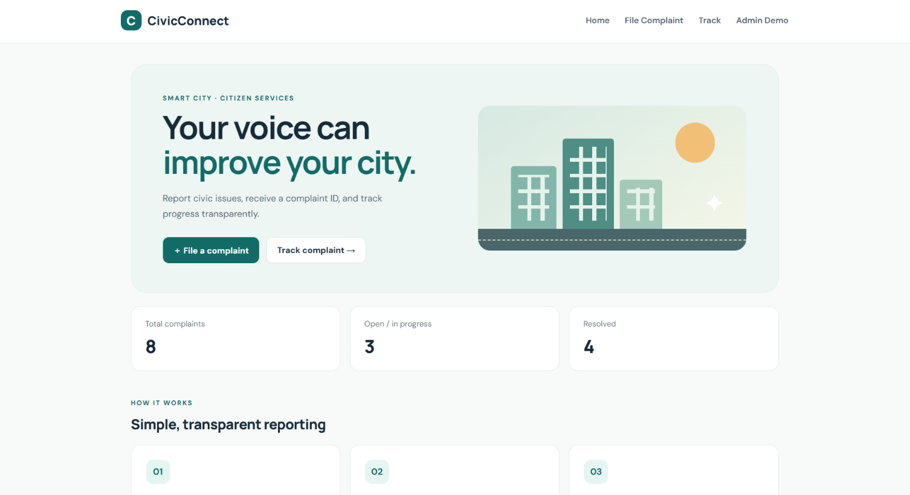
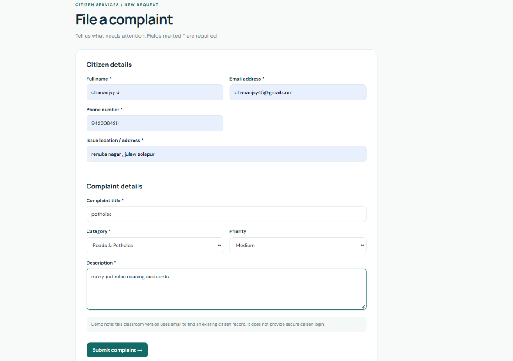

# 🏙️ CivicConnect – Smart City Citizen Grievance Management Platform

A web-based platform that helps citizens report civic issues, track complaints, and enables administrators to manage and resolve grievances efficiently.

## 📌 Project Overview

**CivicConnect** is a Smart City digital platform designed to improve communication between citizens and administrative authorities.

Citizens can submit complaints related to civic issues such as road damage, water supply, waste management, and streetlights. Administrators can review complaints, update their status, and add remarks.

The project demonstrates how digital technologies and database management can support transparent and organized grievance handling.

## ✨ Key Features

- **Complaint Registration:** Citizens can submit complaints through an online form.
- **Complaint Tracking:** Track submitted complaints using a unique complaint ID.
- **Citizen Management:** Store and manage citizen information.
- **Admin Dashboard:** View and manage submitted complaints.
- **Status Updates:** Update complaint progress and add administrative remarks.
- **Complaint History:** Maintain a record of complaint status changes.
- **REST API:** Provides a JSON endpoint for complaint data.

## 🛠️ Technology Stack

| Component | Technology |
|---|---|
| Frontend | HTML, CSS |
| Backend | Python, Flask |
| Database | MongoDB |
| Database Connectivity | PyMongo |
| Environment Configuration | Python dotenv |

## 🏗️ System Architecture

```text
       CITIZEN / ADMIN
              |
              v
       HTML + CSS Interface
              |
              v
         FLASK BACKEND
              |
              v
          PyMongo
              |
              v
          MONGODB
              |
      -------------------
      |        |        |
   Citizens Complaints History
      |        |        |
   Categories Departments
```

## 🗄️ Database Design

The project uses MongoDB with the database:

`citizen_grievance_db`

The following collections are implemented:

| Collection | Purpose |
|---|---|
| `citizens` | Stores citizen information |
| `complaints` | Stores complaint details |
| `categories` | Stores complaint categories |
| `departments` | Stores department information |
| `complaint_history` | Maintains complaint status history |

MongoDB ObjectId is used to uniquely identify database documents and complaints.

## ⚙️ Installation and Setup

### 1. Clone the Repository

```bash
git clone https://github.com/dhanashreedhanshetti-eng/CivicConnect-Smart-City-Platform.git
```

### 2. Open the Project Folder

```bash
cd CivicConnect-Smart-City-Platform
```

### 3. Create a Virtual Environment

```bash
python -m venv .venv
```

### 4. Activate the Virtual Environment

**Windows:**

```powershell
.venv\Scripts\activate
```

### 5. Install Dependencies

```bash
pip install -r requirements.txt
```

### 6. Configure Environment Variables

Refer to `.env.example` and create your local `.env` file with the required configuration.

Do not upload your actual `.env` file or database credentials to GitHub.

### 7. Start MongoDB

Make sure your MongoDB server is running and the connection settings are configured correctly.

### 8. Run the Application

### Home Dashboard

The main dashboard provides an overview of the platform, complaint statistics,
and quick navigation to complaint registration and tracking.



```bash
python app.py
```

Open the local URL displayed in your terminal in a web browser.

### Complaint Registration

Enables citizens to submit civic grievances by providing
citizen details, issue location, category, priority, and description.



## 🔄 How It Works

1. Citizens access the CivicConnect platform.
2. They submit complaints by selecting a category and entering the required details.
3. Complaint information is stored in MongoDB.
4. Citizens track complaints using their unique complaint ID.
5. Administrators review complaints and update their status.
6. Complaint history records the changes.

## 📸 Screenshots

Add screenshots of your actual application here to demonstrate its interface.

Suggested screenshots:
- Home Page / Dashboard
- Complaint Registration Page
- Complaint Tracking Page
- Admin Dashboard
- MongoDB Collections

## 🚀 Future Enhancements

- Secure administrator authentication and role-based access.
- Email and SMS notifications for complaint updates.
- Interactive analytics dashboard.
- Complaint location mapping.
- AI-based complaint classification and prioritization.
- Integration with additional database technologies for advanced analysis.

## 🔐 Security Note

This project is an academic prototype. The current admin interface does not include production-grade authentication. Additional security measures, including access control, input validation, CSRF protection, and secure deployment configuration, are required before real-world use.

## 🎯 Project Objective

To develop a digital grievance management platform that simplifies complaint registration, improves tracking, and supports efficient civic issue management through database technology.

## 👩‍💻 Developed By

**Dhanashree Dhanshetti**

GitHub: [dhanashreedhanshetti-eng](https://github.com/dhanashreedhanshetti-eng)

---

---

## 🎥 Project Demo

Watch CivicConnect in action:

[▶️ View CivicConnect Demo](demo/civicconnect-demo.mp4)

---

<p align="center">
  <b>Building smarter cities through better citizen connectivity.</b>
</p>


⭐ If you find this project interesting, consider giving the repository a star!